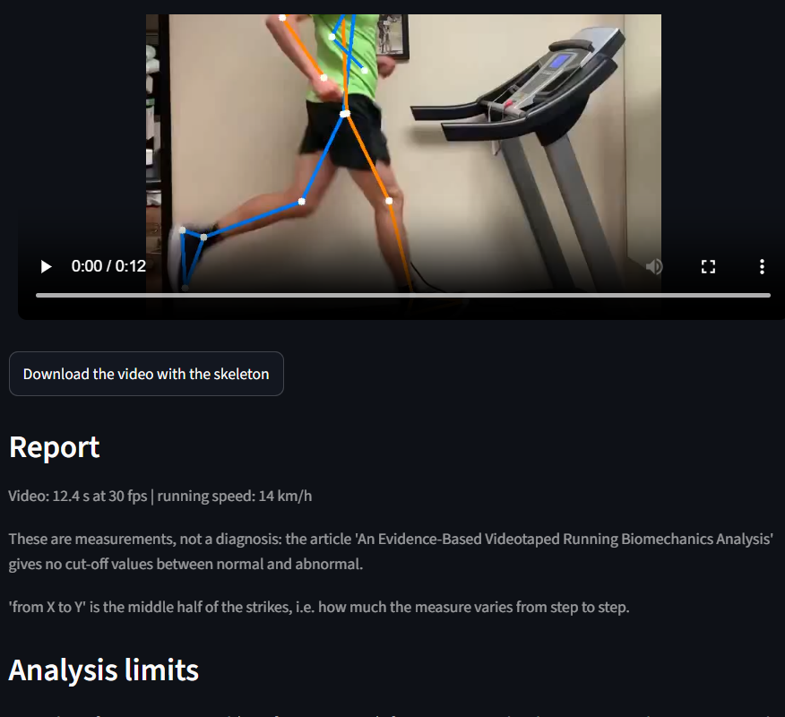

# AI-Coaching

AI-powered sports technique analysis. Upload a video of yourself, get measurements of your
movement and short tips in plain language that you can discuss with a coach or a health
professional.

> **Status: early prototype.** Running and cycling have been tried on a few real videos. Squat and
> bench press are new and have only been checked on simulated data. None of them has been
> validated against a reference system, so treat every number as approximate.


## Try it online

**[Open the app](https://ai-coaching-awyt3ladz87argtgwttf3k.streamlit.app/)**: choose the sport, upload a video and read the report. 
The free hosting puts the app to sleep when nobody uses it: if you see a "wake up" button, click it and wait a minute.

Do not upload videos of other people without their permission: in the online version, videos are
processed on the hosting provider's servers.
-->

## Sports

| Sport | Camera | What the report gives | Details |
|---|---|---|---|
| Running | Side view: treadmill with a still camera, or outdoors with the camera following the runner | Cadence, vertical oscillation, trunk lean, knee flexion, foot landing and tibia angle (when reliable) | [Running](docs/running/README.md) |
| Cycling | Right side of the bike, fixed camera, bike on a trainer or rollers | Saddle height advice from the knee angle; other joint angles measured without advice | [Cycling](docs/cycling/README.md) |
| Squat | **Side view**, camera at hip height, one side of the body facing it | Depth, chest and shin lean, heels; tips on hips or knees, heels and depth | [Squat](docs/squat/README.md) |
| Bench press | **Foot end of the bench**, camera raised and tilted down | Hand width, bar tilt, repetitions; tips on grip width and bar tilt | [Bench press](docs/bench-press/README.md) |

More sports can be added: see [Adding a sport](#adding-a-sport).

## What the app looks like



The app draws the detected skeleton on your video, so you can check that the tracking is right
before trusting any number. If the skeleton does not follow the body, the measurements are not
reliable.

## How it works

1. **Pose estimation** with [MediaPipe](https://developers.google.com/mediapipe): body landmarks
   (shoulders, elbows, wrists, hips, knees, ankles, heels, toes) in every frame.
2. **Event detection**: for example foot touchdown in running, the bottom of the pedal stroke in
   cycling, the lowest point of a squat or a bench press repetition.
3. **Biomechanical measures** computed from the landmarks: joint angles, distances, cadence.
4. **A plain-language report** that shows only what the recording allows to measure, and says
   which measures are not reliable.

## How the tips are labelled

The advice is written for people who know nothing about the sport. Every tip says how solid it is,
with one of three labels:

| Label | Meaning |
|---|---|
| **backed by research** | measured in your video and supported by a study |
| **coach's tip** | measured in your video, but common coaching advice that the studies we read did not test |
| **check it yourself** | the camera cannot see it, so you have to check it alone |

The tips come from a table of rules in the code, not from a model trained on the papers: each
rule says what is measured, when it applies, what to try, why, and which paper it comes from.
The numbers, the research and the limits are in the section "Details and research behind this
result" of each report. The shared code is in `src/common/advice.py`.

At the moment the squat and bench press reports use these labels everywhere. Running and cycling
still use their older, more technical report format and will be moved to the same one.

## Principles

- **No diagnosis.** This is not a medical device. If you have pain or an injury, talk to a health
  professional.
- **Advice only where the research supports it.** When the papers give no reference value for a
  measure, the report shows the measurement and says there is no advice, instead of inventing one.
- **Every threshold is labelled.** Values that come from a paper are cited; values chosen by this
  project are marked as assumptions at the top of each sport's code file.
- **Limits are stated.** Each report says how many repetitions were analysed, how much the
  measures vary, and what a single 2D video cannot show.

## Install (Windows, PowerShell)

Python **3.9 to 3.12** is required: MediaPipe 0.10.14 does not support newer versions.

```powershell
git clone https://github.com/skygio03/AI-Coaching.git
cd AI-Coaching
python3.12 -m venv .venv
.venv\Scripts\activate
python -m pip install -r requirements.txt
```

## Use

Web interface:

```powershell
streamlit run app.py --server.maxUploadSize 500
```

Open the address shown in the terminal (usually http://localhost:8501), choose the sport from the
drop-down menu, answer the question about how the video was filmed, upload the video and press
**Analyse**. The page shows the video with the detected skeleton, the tips, and the technical
details.

Command line (see each sport's page for the options):

```powershell
python -m src.sports.running data\input\video.mp4 14 treadmill
python -m src.sports.cycling data\input\video.mp4
python -m src.sports.squat data\input\video.mp4 right
python -m src.sports.bench_press data\input\video.mp4
```

Checks of the squat and bench press code on simulated data (no video needed):

```powershell
python -m tests.test_gym_synthetic
```

## Project structure

```
app.py                    Streamlit interface
requirements.txt
packages.txt              system libraries needed by Streamlit Community Cloud
docs/
  images/                 screenshot of the interface (used in this README)
  running/                README and images of the running analysis
  cycling/                README and images of the cycling analysis
  squat/                  README and images of the squat analysis
  bench-press/            README and images of the bench press analysis
src/
  common/                 shared by all sports
    pose_extractor.py     MediaPipe landmarks from a video
    render.py             skeleton drawing and browser-friendly video encoding
    advice.py             tips with labels, formatted for the report
  sports/
    running.py            running analysis and report
    cycling.py            cycling analysis and report
    squat.py              squat analysis and report
    bench_press.py        bench press analysis and report
tests/
  test_gym_synthetic.py   squat and bench press checks on simulated body points
data/                     your videos and outputs (not tracked by git)
```

## Adding a sport

Create `src/sports/<sport>.py` with an `analyze_video(video, speed_kmh, output_dir, recording)`
function that returns the same dictionary as `running.analyze_video`, plus the module attributes
used by `app.py` (`RECORDING_OPTIONS`, `OPTION_QUESTION`, `VIDEO_NOTE`, `filming_tips()`, and
optionally `NOTICE` to warn that the analysis is new, or `SPEED_HELP` if the sport uses a speed;
see `squat.py` for a complete example that uses the tips of `src/common/advice.py`). Then add the
module to the `SPORTS` dictionary in `app.py` and create a `docs/<sport>/README.md`.

## Limitations

- 2D video from a single camera: perspective and camera position affect the measures.
- Each sport uses one camera view; nothing is measured from the views that are not described.
- No validation yet against a reference system (for example manual angle measurement or motion
  capture).
- Videos are processed locally and deleted from the temporary folder when the analysis ends. If
  you host this app online, uploaded videos will contain people and are processed on the hosting
  provider's servers: decide what is stored and write a privacy notice first.