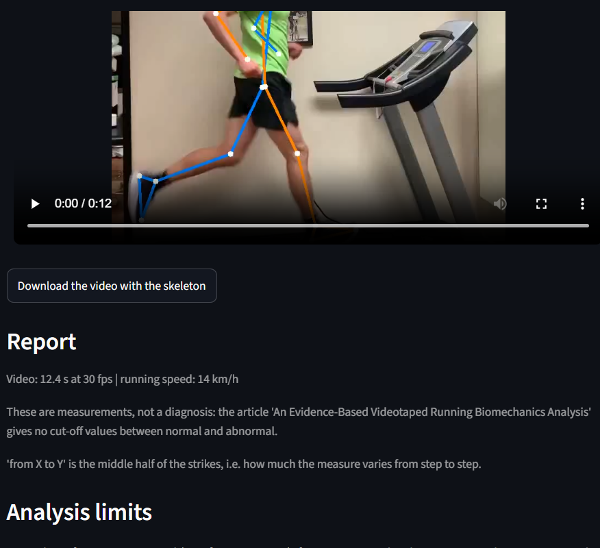

# AI-Coaching

AI-powered sports technique analysis. Upload a video of yourself, get measurements of your
movement and a plain-language report you can discuss with a coach or a health professional.

> **Status: early prototype.** Running and cycling are implemented. Both have been tested on very
> few videos and have not been validated against a reference system, so treat every number as
> approximate.

## Try it online

**[Open the app](https://ai-coaching-awyt3ladz87argtgwttf3k.streamlit.app/)**: choose the sport, upload a side-view video and read the report. The free hosting puts the app to sleep when nobody uses it: if you see a "wake up" button, click it and wait a minute.

Do not upload videos of other people without their permission: uploaded videos are processed on the hosting provider's servers.

## Sports

| Sport | Camera setup | What the report gives | Details |
|---|---|---|---|
| Running | Side view: treadmill with a still camera, or outdoors with the camera following the runner | Cadence, vertical oscillation, trunk lean, knee flexion, foot landing and tibia angle (when reliable) | [Running](docs/running/README.md) |
| Cycling | Right side of the bike, fixed camera, bike on a trainer or rollers | Knee angle at the bottom of the pedal stroke and **saddle height advice**; other joint angles measured without advice | [Cycling](docs/cycling/README.md) |

More sports can be added: see [Adding a sport](#adding-a-sport).

## What the app looks like



The app draws the detected skeleton on your video, so you can check that the tracking is right
before trusting any number. If the skeleton does not follow the body, the measurements are not
reliable.

## How it works

1. **Pose estimation** with [MediaPipe](https://developers.google.com/mediapipe): body landmarks
   (shoulders, elbows, wrists, hips, knees, ankles, heels, toes) in every frame.
2. **Event detection**: for example foot touchdown in running, or the bottom of the pedal stroke
   in cycling.
3. **Biomechanical measures** computed from the landmarks: joint angles, distances, cadence.
4. **A plain-language report** that shows only what the recording allows to measure, and says
   which measures are not reliable.

## Principles

- **No diagnosis.** This is not a medical device. If you have pain or an injury, talk to a health
  professional.
- **Advice only where the research supports it.** When the papers give no reference value for a
  measure, the report shows the measurement and says there is no advice, instead of inventing one.
- **Every threshold is labelled.** Values that come from a paper are cited; values chosen by this
  project are marked as assumptions at the top of each sport's code file.
- **Limits are stated.** Each report says how many repetitions were analysed, how much the
  measures vary, and what a single 2D video cannot show.

## Install (Windows, PowerShell)

Python **3.9 to 3.12** is required: MediaPipe 0.10.14 does not support newer versions.

```powershell
git clone https://github.com/skygio03/AI-Coaching.git
cd AI-Coaching
python3.12 -m venv .venv
.venv\Scripts\activate
python -m pip install -r requirements.txt
```

## Use

Web interface:

```powershell
streamlit run app.py --server.maxUploadSize 500
```

Open the address shown in the terminal (usually http://localhost:8501), choose the sport from the
drop-down menu, answer the question about how the video was filmed, upload the video and press
**Analyse**. The page shows the video with the detected skeleton, the report, and the technical
details.

Command line (see each sport's page for the options):

```powershell
python -m src.sports.running data\input\video.mp4 14 treadmill
python -m src.sports.cycling data\input\video.mp4
```

## Project structure

```
app.py                    Streamlit interface
requirements.txt
packages.txt              system libraries needed by Streamlit Community Cloud
docs/
  images/                 screenshot of the interface (used in this README)
  running/                README and images of the running analysis
  cycling/                README and images of the cycling analysis
src/
  common/                 shared by all sports
    pose_extractor.py     MediaPipe landmarks from a video
    render.py             skeleton drawing and browser-friendly video encoding
  sports/
    running.py            running analysis and report
    cycling.py            cycling analysis and report
data/                     your videos and outputs (not tracked by git)
```

## Adding a sport

Create `src/sports/<sport>.py` with an `analyze_video(video, speed_kmh, output_dir, recording)`
function that returns the same dictionary as `running.analyze_video`, plus the module attributes
used by `app.py` (`RECORDING_OPTIONS`, `OPTION_QUESTION`, `VIDEO_NOTE`, `filming_tips()`, and
`SPEED_HELP` only if the sport uses a speed; see `cycling.py` for a short example). Then add the
module to the `SPORTS` dictionary in `app.py` and create a `docs/<sport>/README.md`.

## Limitations

- 2D video from a single camera: perspective and camera position affect the measures.
- Only the side view is analysed; nothing is measured from behind or in front.
- No validation yet against a reference system (for example manual angle measurement or motion
  capture).
- - Run locally, videos stay on your computer and are deleted from the temporary folder when the analysis ends. In the online version, videos are processed on the hosting provider's servers and the app does not keep them, but the hosting provider's own policy applies.