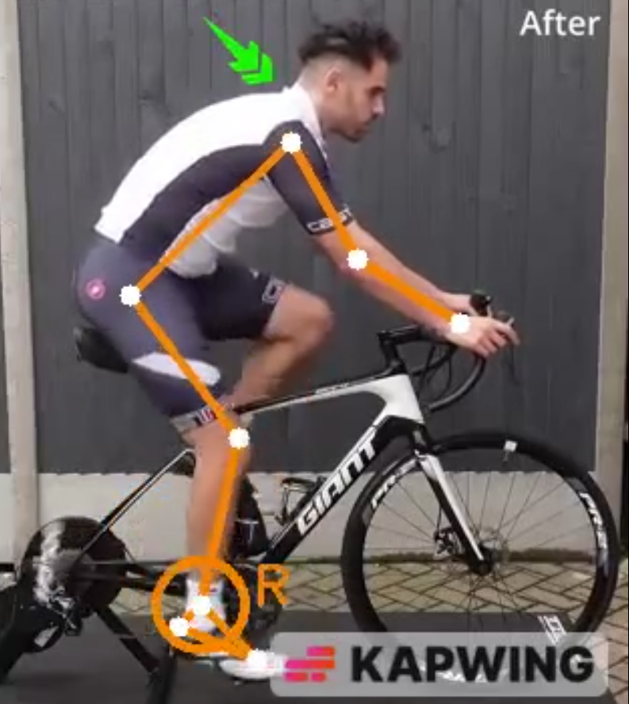

# Cycling analysis

Back to the [general README](../../README.md) · code: [`src/sports/cycling.py`](../../src/sports/cycling.py)

Upload a side-view video of yourself pedalling on a trainer or rollers. The report tells you, in
plain language, whether your **saddle height** looks fine, too low or too high, and shows a few
other measures without advice.



*The app draws only the right side of the body (orange). A ring marks the bottom of each pedal
stroke (lowest point of the right ankle).*

## How to film

- Camera on the **right side** of the bike, so that the right side of your body faces the camera.
  The left side is not analysed.
- Fixed camera, perpendicular to the bike, on a tripod at about hip height, with the whole bike
  and rider in frame.
- Warm up and pedal for at least 2 minutes at the effort and cadence you want to analyse, then
  film at least 10-15 seconds of steady pedalling (at least 10 pedal revolutions are needed).
- Tight-fitting clothing and good light. 60 fps or more if possible.
- Camera side, camera height, 60 fps and clothing are suggestions of this project; the warm-up
  and the number of cycles come from a 2024 consensus statement.

## What the report does

| Measure | What the report does with it |
|---|---|
| Knee flexion at the bottom of the pedal stroke | **Advice on saddle height**, only when it is clearly outside the ranges of the studies |
| Knee range, ankle angle and range, hip angle | Measured and shown in the details, no advice |
| Hip-to-hands distance, ankle movement, back angle | Measured, **no advice**: none of the papers read gives a reference value |
| Pedalling rate | Measured |

The first part of the report is short and written for someone who knows nothing about cycling.
The numbers, the comparison with the studies and the research summary are in a separate section
(the expander "Details and research behind this result" in the app).

## How the saddle advice is decided

The knee angle at the bottom of the stroke (0° = straight leg) is compared with three ranges that
are kept **separate**, because they come from different sources, intensities and goals:

| Range | Source |
|---|---|
| 33-43° | 2019 review, low intensity, dynamic measurement |
| 30-40° | 2019 review, high intensity, dynamic measurement |
| 25-35° | 2024 review, depending on peak power or efficiency priority |

Advice is given only when:

1. the knee angle is outside **all** the ranges by more than 10° (a 2024 consensus statement cites
   about 11° of difference between two ways of measuring it), and
2. the angle is stable from one revolution to the next (spread within 10°), and
3. at least 10 pedal revolutions were analysed.

When advice is given, the change is computed from simple geometry: target knee flexion 35°, leg
of 85 cm (thigh + shank), at most 10 mm per step (rounded to 5 mm). The report asks you to change
only the saddle, one step at a time, and to film again after each step.

Static values, such as the 25-30° of the Holmes method with the rider seated, are a **different
method** and are not comparable with this dynamic measurement from video.

## Assumptions of this project

These are choices of this project, not values from the papers. They are listed at the top of
`src/sports/cycling.py`:

- target knee flexion of 35° (middle of the ranges) and a leg of 85 cm for the millimetre estimate;
- tolerance of 10° outside the ranges, spread of at most 10°, step of at most 10 mm;
- at least 10 revolutions and 10 seconds of video;
- the lowest point of the ankle as an approximation of the 6 o'clock crank position.

## What is not measured

- Curvature of the lumbar spine (the back angle only joins shoulder and hip).
- Knee tracking in the frontal plane (a front view would be needed).
- Foot position on the pedal, saddle fore-aft position and tilt, handlebar reach, crank length,
  cleat position and hand position: the bike itself is not measured.
- The left leg.

## Limitations and validation

- Tested on **one video found online**, with unknown saddle height. The saddle advice has **not**
  been checked against real saddle changes on the same rider or against manual angle measurement.
- 2D video: perspective, a camera that is not perpendicular, and pose-model errors at the hip can
  bias the knee angle. A stable value across revolutions does not rule out a systematic error.
- Studies of freely chosen positions (Holliday & Swart 2021: knee 36° static, hip 77°, shoulder
  112°, elbow 19°, ankle 116°, saddle height plus crank 95-99% of trochanteric leg length) describe
  what 50 well-trained men do, not what is optimal, so they are **not** used as cut-offs.
- Most studies involve men, trained or competitive cyclists; findings may not describe a
  recreational rider. None of the studies in the 2024 review was rated good quality.
- No diagnosis. For knee or back pain, see a physiotherapist or a bike fitter.

## Command line

```powershell
python -m src.sports.cycling data\input\video.mp4
```

## Sources

- Bini, Hume and Croft (2011), *Sports Medicine*: Effects of Bicycle Saddle Height on Knee Injury
  Risk and Cycling Performance (full text read).
- Priego-Quesada et al. (2024), *Sports Medicine*: Bicycle Set-Up Dimensions and Cycling
  Kinematics: A Consensus Statement Using Delphi Methodology (full text read).
- Husband et al. (2024), *Journal of Sports Sciences*: Cycling position optimisation - a
  systematic review of the impact of positional changes on biomechanical and physiological
  factors in cycling (full text read).
- Johnston et al. (2017), *International Journal of Sports Physical Therapy*: The influence of
  extrinsic factors on knee biomechanics during cycling: a systematic review of the literature
  (full text read).
- Bini and Bini (2018), *Open Access Journal of Sports Medicine*: Potential factors associated
  with knee pain in cyclists: a systematic review (full text read).
- Streisfeld et al. (2017), *Sports Health*: Relationship Between Body Positioning, Muscle
  Activity, and Spinal Kinematics in Cyclists With and Without Low Back Pain: A Systematic Review
  (full text read).
- Bini and Priego-Quesada (2022), *Journal of Sports Sciences*: Methods to determine saddle
  height in cycling and implications of changes in saddle height in performance and injury risk:
  A systematic review (abstract only).
- Swart and Holliday (2019), *Current Sports Medicine Reports*: Cycling biomechanics optimization
  - the (R)evolution of bicycle fitting (abstract only): source of the dynamic knee-angle ranges
  by intensity.
- Holliday and Swart (2021), *Sports Medicine and Health Science*: Anthropometrics, flexibility
  and training history as determinants for bicycle configuration (read; descriptive values, not
  used as thresholds).