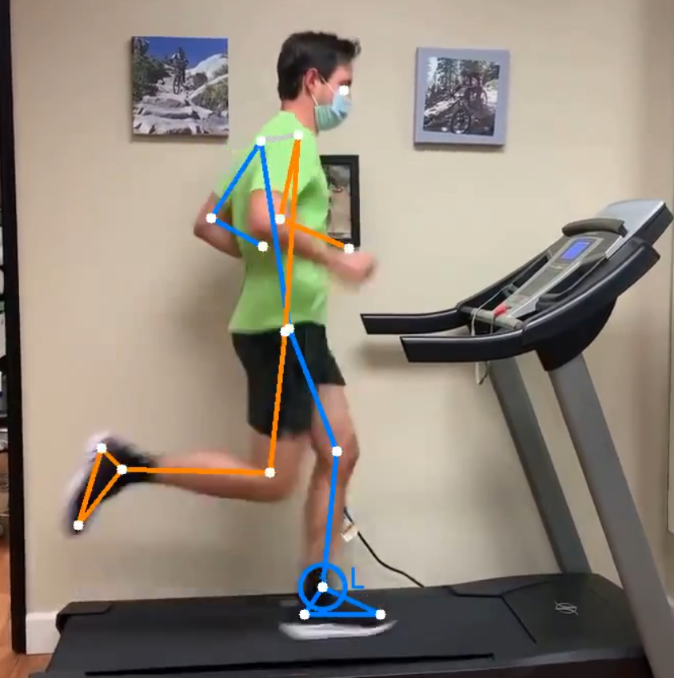

# Running analysis

Back to the [general README](../../README.md) · code: [`src/sports/running.py`](../../src/sports/running.py)

Upload a side-view video of yourself running and get measures of your running form, how much they
vary from step to step, and how reliable each one is for that recording.



*Example from a 30 fps video. Left side in blue, right side in orange; a ring marks each foot
touchdown found by the analysis (L = left foot, R = right foot). If the skeleton does not follow
the body, the measurements are not reliable.*

## Basis of the measures

The measures follow the article
[*An Evidence-Based Videotaped Running Biomechanics Analysis*](https://pmc.ncbi.nlm.nih.gov/articles/PMC4714754/).
That article gives **no cut-off values** between normal and abnormal running, so this project
does not label anything as "wrong". It reports measurements, how much they vary from step to
step, and how reliable they are. The report also summarises research on cadence and has a section
listing what it does **not** recommend (for example, a universal 180 steps per minute, or changing
foot strike for every runner).

## How to film

Two setups are supported. A still camera on a runner who moves across the frame is not supported.

| Option in the app | Setup |
|---|---|
| Treadmill (camera still) | Camera on a tripod, side view, perpendicular to the running direction |
| Outdoors, camera following the runner | Camera moving alongside the runner at the same speed |

- Whole body always in frame, tight-fitting clothing, good light.
- 120 frames per second or more if possible (slow-motion mode on a phone).
- At least 10-15 seconds of continuous running at a steady speed.
- On a treadmill: run 6-10 minutes before filming, at the speed of a long run.
- Optional: enter the running speed. It is only written in the report, because speed changes
  running kinematics: it is useful for comparing videos recorded at the same speed.

## What is measured

| Measure | Reliability with a 30 fps video |
|---|---|
| Cadence | Good |
| Vertical oscillation of the pelvis | Good |
| Trunk lean | Good (depends on how level the camera is) |
| Knee flexion at touchdown and in stance | Fair |
| Foot landing position relative to the pelvis (% of leg length) | Poor: shown only as a range |
| Tibia angle at loading response | Poor: not shown below 100 fps |
| Ground contact time | Not reliable: not reported |

The reliability column comes from testing on a single 30 fps video: the foot landing position and
the tibia angle changed noticeably when the frame they are read at moved by just one frame (33 ms).
They are therefore shown as exact values only for videos of 100 fps or more, which has not been
tested yet.

Left/right differences are reported only when the middle halves of the two distributions do not
overlap, and they may be caused by the camera position (the leg closest to the camera is tracked
better) rather than by the runner.

## How it is computed

- **Touchdown and toe-off** come from the height of the foot above a local ground level.
- **Cadence** from the time between strides.
- **Knee flexion** = 180° minus the interior hip-knee-ankle angle (0° = straight leg).
- **Loading response** is read 50 ms after touchdown (for the tibia angle and the landing
  position). A sensitivity test moves this frame by one to three frames to show how much the
  result depends on it.
- **Landing position**: horizontal distance between foot and pelvis at touchdown, as a percentage
  of leg length.

## Assumptions of this project

These are choices of this project, not values from the article. They are listed at the top of
`src/sports/running.py`:

- foot-height level that defines touchdown: 0.83 (tuned on one video);
- loading response 50 ms after touchdown;
- at least 100 fps to show the landing position and tibia angle as exact values;
- minimum of 8 strikes per leg and 10 seconds of video.

## Command line

```powershell
python -m src.sports.running data\input\video.mp4 14 treadmill
```

The second argument is the speed in km/h (optional) and the last one is `treadmill` or
`following`.

## Limitations

- Tested on very few videos; not validated against a reference system.
- Only the side view: nothing is measured from behind or in front (hip drop, foot crossover).
- At 30 fps, events are located to within about 33 ms, which is too coarse for some measures
  (see the table above).
- No diagnosis, and no injury-specific advice.